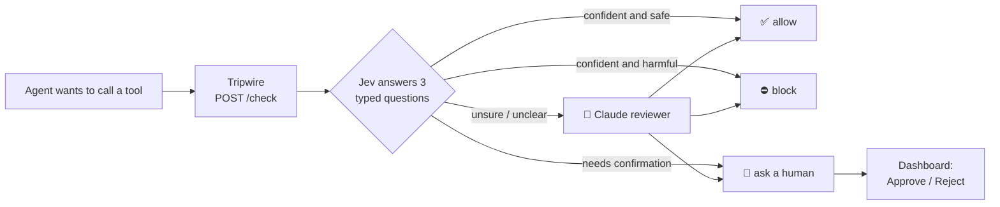

# 🪤 Tripwire

**A safety and approval gate between your AI agent and its tools.**

Agents with real tool access can delete data, send emails, or run SQL they were never asked to run. Asking a big model to review every call is slow and expensive; approving everything by hand doesn't scale. Tripwire sits in the middle: a fast decision model ([Jev](https://vercel.com/ai-gateway/models/typesafe-ai/jev) by TypeSafe AI) scores every tool call in one cheap request, routine calls go straight through, risky ones are blocked or held for a human, and only the uncertain ones are escalated to Claude.


---

## How it works



For every proposed tool call, Jev answers three typed questions in a **single request** and returns probabilities, not text, so there is nothing to parse:

| Question | Type | Meaning |
| --- | --- | --- |
| `is_destructive` | probability | Could this delete or overwrite data, spend money, or send something externally? |
| `off_task` | probability | Does this go beyond what the user's goal asked for? |
| `decision` | choice + confidence | `allow`, `ask_human`, `block`, or `unclear` |

Tripwire then applies a policy on top:

| Situation | Result |
| --- | --- |
| Jev is confident and says `allow`, destructive and off-task are both low | **allow** |
| Jev is confident and says `block` | **block** |
| Jev says `ask_human` | **pending**, waits for a person |
| Jev says `allow`, but destructive or off-task probability is above its threshold | **pending** (policy override) |
| Jev says `unclear`, or confidence is below the threshold | **Claude reviews it**; with no Claude key, a person decides |
| Jev is unreachable or returns something malformed | **fail closed**: never silently allowed |

---

## Quick start

```bash
python -m venv .venv && source .venv/bin/activate    # Windows: .venv\Scripts\activate
pip install -r requirements.txt
uvicorn app.main:app --reload
```

Then open:

- **http://localhost:8000/dashboard**: live audit trail with Approve / Reject buttons
- http://localhost:8000/docs: the raw API (Swagger UI)

With no API keys, Tripwire runs on a **local mock** instead of real Jev so you can try everything immediately. `GET /health` shows `"jev": "mock"` when that is the case.

> ⚠️ The mock is a keyword heuristic for development only. It is **not** a safety mechanism.

### Try the demo agent

With the server running, open a second terminal:

```bash
python examples/demo_agent.py
```

The demo agent has the goal *"Delete the old temp logs, then summarise the sales report"* and tries four tool calls:

| Tool call | What happens |
| --- | --- |
| `read_file("sales_report.csv")` | ✅ runs immediately |
| `delete_file("/tmp/old.log")` | 🙋 pauses until you click **Approve** on the dashboard |
| `send_email(...)` to a stranger | ⛔ blocked (not part of the goal) |
| `run_sql("DROP TABLE customers")` | ⛔ blocked |

---

## Guard your own agent

Copy the `tripwire_sdk/` folder next to your agent code (it only needs `httpx`) and add one decorator per tool:

```python
from tripwire_sdk import Tripwire, ActionBlocked, ActionRejected, ApprovalTimeout

tw = Tripwire("http://localhost:8000", agent_id="my-agent")

@tw.guard                      # works on sync and async functions
def delete_file(path: str):
    ...

@tw.guard(tool="db.run_sql")   # optional custom tool name
async def run_sql(query: str):
    ...

with tw.goal("Clean up old temp logs"):          # the user's original request
    try:
        delete_file("/tmp/old.log")
    except ActionBlocked as e:
        print("Blocked:", e.reason)
    except (ActionRejected, ApprovalTimeout):
        print("A human said no, or nobody answered in time")
```

**The SDK fails closed.** The wrapped function does *not* run if Tripwire is unreachable, the call is blocked, a human rejects it, or nobody answers within `approval_timeout` (default 300 s). A missing goal is an error, not a silent allow.

---

## Use real Jev and Claude

Copy `.env.example` to `.env` (in the folder where you run `uvicorn`), fill in what you have, then **restart the server**. Check http://localhost:8000/health: it should say `"jev": "live"`.

| Variable | Purpose |
| --- | --- |
| `AI_GATEWAY_API_KEY` | Call Jev through Vercel AI Gateway (no TypeSafe waitlist) |
| `TYPESAFE_API_KEY` | Call Jev directly through TypeSafe (waitlist) |
| `ANTHROPIC_API_KEY` | Enables the Claude fallback reviewer for uncertain calls |
| `CLAUDE_MODEL` | Reviewer model (default `claude-sonnet-5-5`) |
| `DATABASE_URL` | SQLite by default; use Postgres in production |
| `TRIPWIRE_LOW_CONFIDENCE` | Below this Jev confidence, escalate (default `0.6`) |
| `TRIPWIRE_DESTRUCTIVE_THRESHOLD` | Override an `allow` above this destructive probability (default `0.8`) |
| `TRIPWIRE_OFF_TASK_THRESHOLD` | Override an `allow` above this off-task probability (default `0.8`) |

---

## API

| Endpoint | Purpose |
| --- | --- |
| `POST /check` | Agent submits `{goal, tool, arguments, agent_id?}` and gets a verdict |
| `GET /actions?status=pending` | Audit log, filterable by status and limit |
| `GET /actions/{id}` | One action (the SDK polls this while an action is `pending`) |
| `POST /approvals/{id}` | A human approves or rejects a pending action |
| `GET /health` | Whether Jev and the Claude reviewer are live or mocked |
| `GET /dashboard` | The web dashboard |

Action statuses: `allowed`, `blocked`, `pending`, `approved`, `rejected`.

---

## Troubleshooting

| What you see | Cause and fix |
| --- | --- |
| `/health` says `"jev": "mock"` | The key isn't being read. Put it in a file named `.env` (not `.env.example`) in the folder where you run `uvicorn`, as `AI_GATEWAY_API_KEY=...`, then restart the server. |
| Dashboard shows `404`, or the SDK reports `303 See Other` with an `/en-US/...` address | Another program is already using port 8000 (a Django dev server does by default). Start Tripwire on a free port, `uvicorn app.main:app --reload --port 8010`, open `http://localhost:8010/dashboard`, and set `TRIPWIRE_URL=http://localhost:8010` before running the demo agent. |
| An action says `Jev returned HTTP 403 ... customer_verification_required` | Vercel AI Gateway needs a credit card on file before it serves requests; adding one also unlocks its free credits. Add it in the Vercel dashboard under AI Gateway. No code change or restart needed. |
| Every call waits for a human with `Jev unavailable` | This is the fail-closed rule working: if Jev can't be reached, nothing runs without a person's approval. Read the reason on the card; it includes the server's own error message. |

## Project layout

```
tripwire/
├── app/
│   ├── main.py            FastAPI app and endpoints
│   ├── gate.py            decision policy (thresholds, fail-closed rules)
│   ├── jev.py             Jev HTTP client + local mock
│   ├── reviewer.py        Claude fallback reviewer
│   ├── db.py              SQLAlchemy audit-log model
│   ├── schemas.py         Pydantic models
│   ├── config.py          environment-based settings
│   └── static/dashboard.html
├── tripwire_sdk/          the @tw.guard decorator (sync + async)
├── examples/demo_agent.py
├── tests/                 26 tests
└── docs/dashboard.png
```

## Tests

```bash
pytest
```

The tests cover the decision policy, the Jev request/response shapes, the approval flow, and the SDK's fail-closed behaviour (blocked, rejected, timed out, server unreachable, missing goal).

---

## Status and limitations

This is an early version. Being upfront about what has and hasn't been verified:

- **No real Jev decision verified yet.** A live call has reached Vercel AI Gateway with a valid key, but was refused until a credit card was added to the Vercel account (see Troubleshooting). The request and response shapes follow the published TypeSafe / Vercel AI Gateway docs and are covered by unit tests with stubs; expect small fixes on the first successful call. The Claude reviewer path has not been run live either.
- **No authentication.** Anyone who can reach the server can approve actions. Keep it on `localhost` until auth is added.
- **Probabilities need calibration.** Jev's confidence should be checked against real human decisions before you trust the thresholds in production.
- **Jev is text-only and always picks an answer**, which is why the `unclear` option exists.
- Jev's `score` question type is not used yet; this version uses probability (`noul`) and `choice` questions only.

